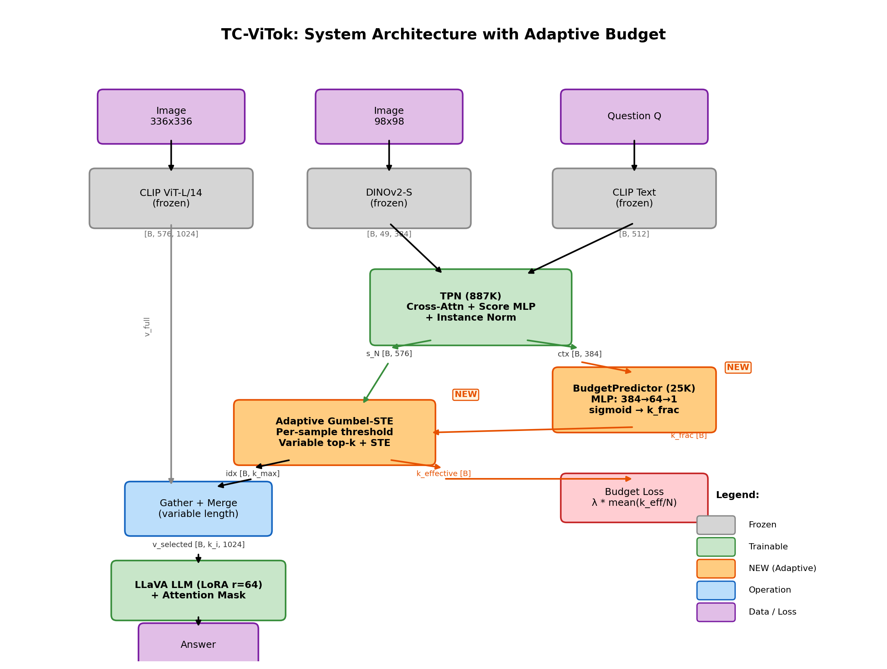
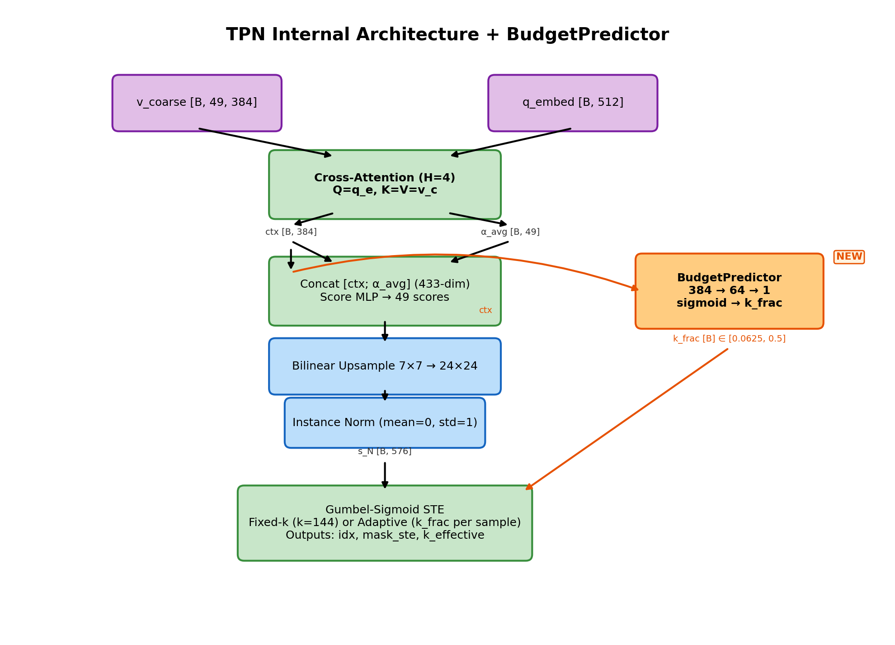
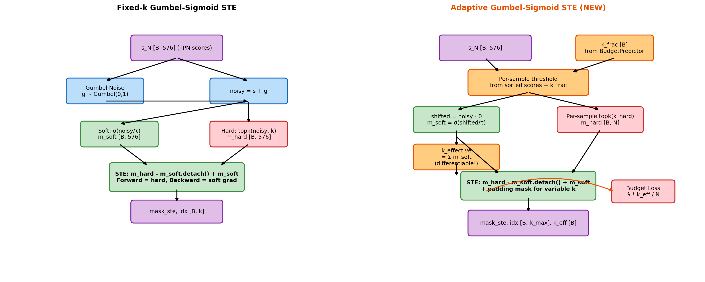
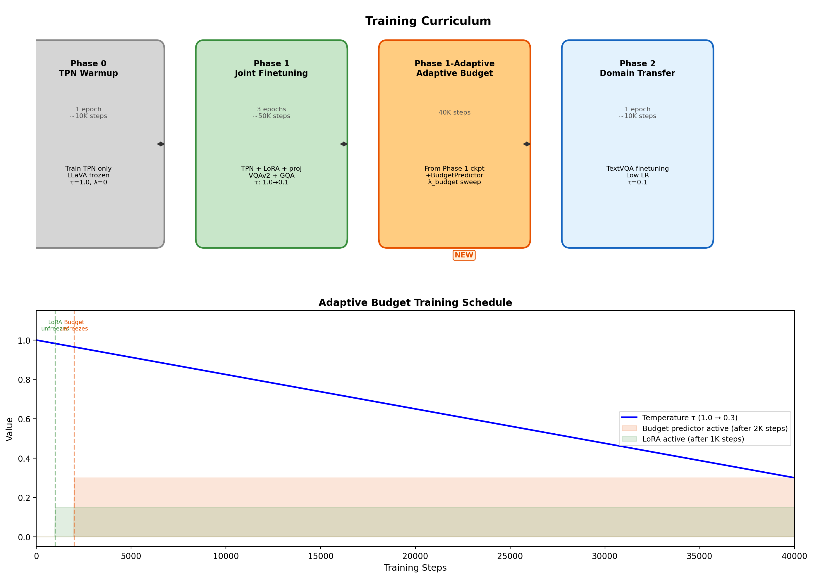

# TC-ViTok: Task-Conditioned Visual Tokenization

**Learning an Adaptive Token Selection Policy for Efficient Vision-Language Reasoning**


Vision-Language Models like LLaVA encode a fixed 576 visual tokens for every image, regardless of query complexity. **TC-ViTok** introduces a lightweight Tokenization Policy Network (TPN, ~887K params) that learns a query-conditioned token selection policy, dynamically choosing only k << 576 relevant tokens. Our **Adaptive Budget** extension adds a BudgetPredictor (~25K params) that learns a per-sample variable token budget — allocating more tokens to hard questions (spatial reasoning, counting, OCR) and fewer to easy ones (yes/no, color recognition). This reduces **LLM-side** computational cost by up to 75-94% depending on the sample (note: the full ViT-L encoder still processes all tokens; net end-to-end savings depend on LLM prefill dominance). Our approach frames visual tokenization as a learned policy problem and trains the TPN via Gumbel-Sigmoid straight-through estimation with a phased curriculum.

---

## Key Idea

Most VLMs use **fixed tokenization**: every image → 576 tokens, regardless of question complexity. We reframe this as a **learned policy problem**:

**Visual Tokenization as Adaptive Policy Learning:**
```
π: (Query Q, Image I_coarse) → (Token Selection Indices S, Token Budget k)
```

Instead of encoding all 576 tokens, TC-ViTok:
1. Extracts **coarse features** (DINOv2-S, 49 tokens) and **text embeddings** (CLIP)
2. Runs **TPN** to predict importance scores for each of 576 spatial locations
3. **BudgetPredictor** determines how many tokens this sample needs (36-288)
4. Selects **top-k indices** via differentiable Gumbel-Sigmoid STE (adaptive or fixed k)
5. **Gathers** selected tokens from full CLIP ViT-L/14 output via `torch.gather` (real compression)
6. Feeds **k gathered tokens** (not N) to **LLaVA** — LLM sees k+L tokens, reducing prefill FLOPs

The **Adaptive Budget** mode replaces fixed k with a per-sample variable budget. By sweeping the budget penalty weight `lambda_budget`, we trace a **Pareto curve** of compression vs. accuracy.

**System Architecture:**



*Gray = frozen encoders; Green = trainable components; Orange = NEW adaptive budget components; Blue = operations; Purple = data tensors. Tensor shapes shown on arrows.*

---

## Architecture

TC-ViTok consists of six main components:

### 1. Coarse Visual Encoder
- **Model:** DINOv2-Small (ViT-S/14)
- **Input:** 98×98 RGB image
- **Output:** 49 spatial tokens (7×7 grid), 384-dim
- **Status:** Frozen (pretrained on ImageNet-22k)
- **Purpose:** Fast low-resolution features for token scoring

### 2. Text Encoder
- **Model:** CLIP ViT-B/32 text encoder
- **Input:** Question string
- **Output:** 512-dim [EOS] embedding
- **Status:** Frozen
- **Purpose:** Question representation for conditional selection

### 3. Tokenization Policy Network (TPN)
- **Architecture:** Cross-attention (4 heads) + concat [ctx; alpha_avg] + Score MLP + bilinear upsample + instance norm
- **Input:** Coarse visual (49×384) + text embedding (512)
- **Output:** Top-k gather indices + instance-normalized scores (576) + context vector (384)
- **Parameters:** ~887K (trainable)
- **Key innovation:** Gumbel-Sigmoid STE for differentiable top-k; returns indices for `torch.gather`

### 4. BudgetPredictor (Adaptive Budget)
- **Architecture:** 2-layer MLP (384 → 64 → 1) + sigmoid
- **Input:** TPN cross-attention context vector `ctx` [B, 384]
- **Output:** Per-sample token fraction `k_frac` ∈ [k_min/N, k_max/N]
- **Parameters:** ~25K (trainable)
- **Key innovation:** Learns per-sample variable budget — allocates more tokens to hard questions, fewer to easy ones
- **Token range:** 36 (6.25%) to 288 (50%) of 576 tokens

### 5. Full Visual Encoder
- **Model:** CLIP ViT-L/14
- **Input:** 336×336 RGB image
- **Output:** 576 spatial tokens (24×24 grid), 1024-dim
- **Status:** Frozen
- **Purpose:** High-resolution features for selected tokens only

### 6. LLaVA Backbone
- **Model:** Vicuna-7B + vision projector
- **Adaptation:** LoRA (rank=64, alpha=128) on q/k/v/o/gate/up_proj
- **Parameters:** 7B (frozen) + ~35M (LoRA trainable)
- **Attention masking:** Per-sample mask handles variable token counts in adaptive mode

### Component Summary

| Component               | Parameters | Trainable | Input Size    | Output Size    |
|-------------------------|------------|-----------|---------------|----------------|
| DINOv2-S (coarse)       | 22M        | ✗ Frozen  | 98×98×3       | 49×384         |
| CLIP Text               | 63M        | ✗ Frozen  | text          | 512            |
| **TPN**                 | **~887K**  | **✓ Yes** | 49×384 + 512  | idx (k) + scores (576) + ctx (384) |
| **BudgetPredictor**     | **~25K**   | **✓ Yes** | ctx (384)     | k_frac [B]     |
| CLIP ViT-L/14 (full)    | 304M       | ✗ Frozen  | 336×336×3     | 576×1024       |
| LLaVA (LoRA + proj)     | ~35M       | **✓ Yes** | k_i×1024      | text           |
| **Total Trainable**     | **~36M**   | **—**     | **—**         | **—**          |

### Architecture Diagrams

**TPN Internal Architecture + BudgetPredictor:**



*Three-stage pipeline: (1) Cross-attention with H=4 heads fuses query q_e with coarse visual v_c, producing context vector ctx and attention weights alpha_avg. (2) Score MLP maps concat [ctx; alpha_avg] (433-dim) to 49 coarse scores. (3) Bilinear upsample 7x7 to 24x24 + instance norm. BudgetPredictor (orange) takes ctx to predict per-sample k_frac.*

---

## Method Summary

### Gumbel-Sigmoid Straight-Through Estimator (STE)

The core technical challenge is making discrete token selection differentiable. We provide two modes:

#### Fixed-k STE (Standard)

1. **Forward pass:** Hard top-k selection (binary mask)
   - Sample Gumbel noise: g ~ Gumbel(0, 1)
   - Compute noisy scores: noisy = s + g
   - Soft mask: m_soft = sigmoid(noisy / tau)
   - Hard mask: topk(noisy, k) → m_hard
   - STE trick: m = m_hard - m_soft.detach() + m_soft

2. **Backward pass:** Soft gradients from Gumbel-Sigmoid
   - Gradient flows through soft m_soft, not hard m_hard

3. **Temperature annealing:** tau: 1.0 → 0.3 (linear schedule)

#### Adaptive STE (Per-Sample Variable k)

Extends fixed-k STE with a per-sample threshold derived from `k_frac`:

1. **Threshold computation:** Sort detached scores, find the boundary at position `k_target`
2. **Differentiable trick:** `threshold = threshold_hard - (k_target - k_target.detach())`
   - Forward: equals threshold_hard exactly (zero effect)
   - Backward: d(threshold)/d(k_frac) = -N (gradient to BudgetPredictor)
3. **Shifted soft mask:** m_soft = sigmoid((noisy - threshold) / tau)
4. **k_effective:** sum(m_soft) — differentiable expected token count for budget loss
5. **Hard selection:** Per-sample topk(k_hard) on noisy scores
6. **Padding:** Shorter samples padded with -1 in idx tensor

**Gumbel-Sigmoid STE Mechanism (Fixed vs. Adaptive):**



*Left: Fixed-k STE with constant token budget. Right: Adaptive STE with per-sample variable budget from BudgetPredictor, producing differentiable k_effective for budget loss.*

### Gradient Flow (Adaptive Mode)

Four gradient paths exist:

| Path | From → To | Status | Mechanism |
|------|-----------|--------|-----------|
| **A** | Budget Loss → BudgetPredictor | Active | `L_budget = mean(k_eff/N)` → threshold → k_frac → BP weights |
| **B** | VQA Loss → TPN Scores | Active | STE correction: `v * (1 + s - s.detach())` routes grad to TPN |
| **C** | VQA Loss → BudgetPredictor | Blocked | No direct path; adaptation emerges through evolving ctx |
| **D** | Entropy Loss → BudgetPredictor | Leak | Pushes k_frac UP; dominated ~5x by budget loss (Path A) |

### Training Curriculum

**Phase 0: TPN Warmup (1 epoch, ~10k steps)**
1. Freeze LLaVA backbone completely
2. Train only TPN on VQAv2 subset
3. Learn basic token selection patterns
4. Fixed temperature tau=1.0; loss = L_VQA only (lambda=0, mu=0)

**Phase 1: Joint Finetuning (3 epochs, ~50k steps)**
1. Train TPN + LoRA + vision projector jointly
2. Full VQAv2 + GQA training sets
3. Temperature annealing (tau: 1.0 → 0.3)
4. Entropy + diversity regularization

**Phase 1-Adaptive: Adaptive Budget (40K steps)**
1. Load Phase 1 checkpoint; initialize BudgetPredictor from scratch
2. Budget warmup: BudgetPredictor frozen for first 2,000 steps
3. LoRA warmfreeze: LoRA frozen for first 1,000 steps
4. Sweep `lambda_budget` ∈ {0.05, 0.1, 0.2, 0.4} to trace Pareto curve
5. Loss = L_VQA + lambda_entropy * (-H) + lambda_diversity * L_div + **lambda_budget * mean(k_eff/N)**

**Phase 2: Domain Transfer (1 epoch, ~10k steps, optional)**
1. Finetune on TextVQA for OCR-heavy questions
2. Lower learning rates (TPN: 5e-5, LoRA: 2e-5)
3. Fixed temperature tau=0.1

**Training Curriculum Overview:**



*Top: Four training phases — Phase 1-Adaptive (orange) is the new adaptive budget phase. Bottom: Training schedule showing temperature annealing, LoRA unfreeze at 1K steps, and BudgetPredictor unfreeze at 2K steps.*

### Loss Function

```
L_total = L_vqa
        + lambda_entropy * (-H)           [spatial diversity, H = Shannon entropy]
        + lambda_diversity * L_div         [query-conditioned diversity]
        + lambda_budget * mean(k_eff / N)  [budget penalty — adaptive mode only]
```

| Loss Term | Weight | Purpose |
|-----------|--------|---------|
| L_vqa | 1.0 | Cross-entropy VQA loss |
| -H (entropy) | 0.02 | Prevent spatial collapse — maximize Shannon entropy of selection |
| L_div (diversity) | 0.1 | Penalize query-ignoring — different questions should select different tokens |
| mean(k_eff/N) | **lambda_budget** | Budget penalty — higher = more compression. **Sweep for Pareto curve** |

### Known Failure Modes & Mitigations

| Failure Mode | Symptom | Fix |
|--------------|---------|-----|
| **Spatial Collapse** | All tokens from same region | Entropy regularization + diversity loss |
| **Query-Ignoring** | Same tokens for all questions | Diversity loss + curriculum warmup |
| **Gradient Vanishing** | mask.grad_fn is None | Verify STE implementation (critical check) |
| **Budget Collapse** | k_effective stuck at k_min or k_max | Check budget warmup; adjust lambda_budget |
| **Token-0 Overwrite** | Padding -1 clamped to 0 corrupts token 0 | Use per-sample scatter with valid mask |

**Detection utilities:** See `src/tc_vitok/evaluation/collapse_detection.py` for automated diagnostics.

---

## Repository Structure

```
tc-vitok/
├── README.md                         # This file
├── ADAPTIVE_BUDGET.md                # Detailed adaptive budget architecture docs
├── LICENSE                           # MIT License
├── .gitignore                        # Python + HuggingFace + data artifacts
├── requirements.txt                  # Pinned dependencies with normalization warnings
├── setup.py                          # Installable package setup
│
├── configs/
│   ├── base.yaml                     # Default hyperparameters (k, tau, lambda, lr, etc.)
│   ├── phase0.yaml                   # Phase 0 warmup config
│   ├── phase1.yaml                   # Phase 1 joint finetuning config
│   ├── phase1_adaptive.yaml          # Phase 1-Adaptive: adaptive budget config (NEW)
│   └── phase2.yaml                   # Phase 2 domain transfer config
│
├── src/
│   └── tc_vitok/
│       ├── __init__.py
│       ├── models/
│       │   ├── __init__.py
│       │   ├── tpn.py                # TPN + BudgetPredictor (cross-attn + score head + budget MLP)
│       │   ├── encoders.py           # CoarseVisualEncoder (DINOv2) + TextEncoder (CLIP)
│       │   ├── masking.py            # gumbel_sigmoid_ste() + adaptive_gumbel_sigmoid_ste()
│       │   └── tc_vitok_model.py     # Full TCViTok wrapper (fixed-k + adaptive gather/masking)
│       │
│       ├── training/
│       │   ├── __init__.py
│       │   ├── losses.py             # VQA, entropy, diversity, budget loss + -1 padding handling
│       │   ├── curriculum.py         # tau_schedule(), lambda_schedule() (Eq. 13-14)
│       │   ├── trainer.py            # Training loop with budget warmup + validation metrics
│       │   └── optimizer.py          # AdamW with per-group lr (incl. BudgetPredictor group)
│       │
│       ├── data/
│       │   ├── __init__.py
│       │   ├── datasets.py           # VQAv2, GQA, TextVQA, POPE dataset loaders
│       │   ├── caching.py            # HDF5 feature cache (coarse ViT + CLIP text)
│       │   └── spatial_labels.py     # Spatial specificity classifier (GQA annotations)
│       │
│       └── evaluation/
│           ├── __init__.py
│           ├── metrics.py            # VQA-score, GQA accuracy, POPE F1
│           ├── spatial_eval.py       # Spatial vs. global question stratification
│           ├── collapse_detection.py # Spatial collapse & query-ignoring diagnostics
│           └── pareto.py             # Accuracy-vs-tokens Pareto curve utilities
│
├── scripts/
│   ├── train.py                      # CLI entry point for training (supports adaptive budget)
│   ├── evaluate.py                   # CLI entry point for evaluation + Pareto sweep
│   ├── cache_features.py             # Precompute and save HDF5 feature cache
│   ├── launch_multigpu.sh            # Multi-GPU DDP launch script
│   ├── visualize_masks.py            # Visualize TPN attention masks on sample images
│   └── generate_diagrams.py          # Generate architecture diagrams (matplotlib)
│
├── notebooks/
│   ├── 01_baseline_reproduction.ipynb   # Phase A: verify LLaVA-1.5 79.1% baseline
│   ├── 02_token_visualization.ipynb     # PCA of 576 tokens as RGB spatial map
│   ├── 03_tpn_debug.ipynb               # Verify grad_fn, STE correctness
│   └── 04_results_analysis.ipynb        # Plot Pareto curves, spatial/global split
│
├── tests/
│   ├── test_tpn.py                   # Unit tests: TPN output shape, grad_fn not None
│   ├── test_masking.py               # STE forward/backward correctness
│   ├── test_adaptive_budget.py       # 14 tests for adaptive budget components (NEW)
│   └── test_spatial_labels.py        # Spatial classifier label distribution sanity
│
└── assets/
    ├── tc_vitok_architecture.png     # End-to-end system architecture (with adaptive budget)
    ├── tpn_architecture.png          # TPN + BudgetPredictor architecture
    ├── training_pipeline.png         # Four-phase curriculum + schedule curves
    └── gumbel_ste.png                # Fixed-k vs. Adaptive Gumbel-Sigmoid STE
```

---

## Installation

### Requirements
- **Python:** ≥ 3.9
- **PyTorch:** ≥ 2.0
- **CUDA:** ≥ 11.8 (for GPU training)

### Step 1: Clone Repository
```bash
git clone https://github.com/whyeventry0103/TC-ViTok.git
cd TC-ViTok
```

### Step 2: Create Virtual Environment
```bash
conda create -n tcvitok python=3.9
conda activate tcvitok
```

### Step 3: Install Dependencies
```bash
pip install -r requirements.txt
```

**Key dependencies:**
- `transformers>=4.36` (LLaVA, CLIP)
- `accelerate` (distributed training)
- `peft>=0.7.0` (LoRA)
- `timm>=0.9.12` (DINOv2)
- `h5py>=3.10.0` (feature caching)
- `einops>=0.7.0` (tensor operations)
- `omegaconf>=2.3.0` (config management)
- `wandb>=0.16.0` (logging)

### Step 4: Install Package
```bash
pip install -e .
```

---

## Quick Start

### 1. Download Pretrained Models

TC-ViTok requires several pretrained checkpoints:

```bash
# LLaVA-1.5-7B (base VLM)
huggingface-cli download llava-hf/llava-1.5-7b-hf

# DINOv2-Small (coarse encoder)
# Automatically downloaded by timm

# CLIP ViT-L/14 (full encoder) and ViT-B/32 (text)
# Automatically downloaded by transformers
```

### 2. Prepare Data

Download VQA datasets:

```bash
# VQAv2
wget https://s3.amazonaws.com/cvmlp/vqa/mscoco/vqa/v2_Annotations_Train_mscoco.zip
wget https://s3.amazonaws.com/cvmlp/vqa/mscoco/vqa/v2_Questions_Train_mscoco.zip

# GQA
wget https://downloads.cs.stanford.edu/nlp/data/gqa/questions1.2.zip

# POPE (for hallucination evaluation)
wget https://github.com/AoiDragon/POPE/raw/main/output/coco/coco_pope_adversarial.json
```

### 3. Cache Features (Optional but Recommended)

Precompute coarse visual and text features for faster training:

```bash
python scripts/cache_features.py \
  --dataset vqav2 \
  --split train \
  --output data/cache/
```

### 4. Run Phase 0 Training

Train TPN with frozen LLaVA:

```bash
python scripts/train.py \
  --config configs/phase0.yaml \
  --output runs/phase0/ \
  --wandb-project tc-vitok
```

### 5. Run Phase 1 Training

Joint finetuning of TPN + LoRA + projector:

```bash
python scripts/train.py \
  --config configs/phase1.yaml \
  --output runs/phase1/ \
  --resume runs/phase0/best.ckpt
```

### 6. Run Adaptive Budget Training

Train with learned per-sample variable token budget:

```bash
# Single run with lambda_budget=0.1
bash scripts/launch_multigpu.sh \
  --config configs/phase1_adaptive.yaml \
  --output runs/adaptive_lb0.1
```

This loads the Phase 1 checkpoint, initializes BudgetPredictor from scratch, and trains for 40K steps.

### 7. Sweep lambda_budget for Pareto Curve

Each run traces one point on the compression-vs-accuracy frontier:

```bash
for lb in 0.05 0.1 0.2 0.4; do
    bash scripts/launch_multigpu.sh \
        --config configs/phase1_adaptive.yaml \
        --output runs/adaptive_lb${lb} \
        training.lambda_budget=${lb}
done
```

### 8. Evaluate on Benchmarks

Evaluate trained model on VQAv2, GQA, and POPE:

```bash
python scripts/evaluate.py \
  --checkpoint runs/adaptive_lb0.1/best.ckpt \
  --config configs/phase1_adaptive.yaml \
  --benchmarks vqav2 gqa textvqa pope
```

### 9. Token Budget Sweep (Fixed-k Pareto Curve)

Evaluate across multiple fixed token budgets (non-adaptive baseline):

```bash
python scripts/evaluate.py \
  --checkpoint runs/phase1/best.ckpt \
  --token-budgets 72 144 216 288 576 \
  --benchmarks vqav2 gqa
```

---

## Experiments & Results

**WARNING: ALL RESULTS BELOW ARE PROJECTED -- NOT MEASURED.**
No experiments have been run yet. These numbers are theoretical estimates based on method structure and prior literature. They will be replaced with measured results after implementation and training are complete. Do not cite these numbers.

### Main Results (Fixed-k Baseline)

| Method                  | VQAv2 | GQA  | GQA-Spatial | POPE-F1 | Tokens |
|-------------------------|-------|------|-------------|---------|--------|
| LLaVA-1.5 (baseline)    | 79.1  | 62.0 | 61.8        | 86.4    | 576    |
| TC-ViTok (k=288)        | 78.3  | 61.2 | 60.5        | 85.8    | 288    |
| TC-ViTok (k=216)        | 77.5  | 60.1 | 59.2        | 85.1    | 216    |
| **TC-ViTok (k=144)**    | **76.2** | **58.9** | **58.1** | **84.3** | **144** |
| TC-ViTok (k=72)         | 73.1  | 55.4 | 53.8        | 81.7    | 72     |

### Adaptive Budget Results (Projected)

The adaptive budget model allocates tokens per-sample, with the average controlled by `lambda_budget`:

| lambda_budget | Avg k | VQAv2 | GQA  | Notes |
|---------------|-------|-------|------|-------|
| 0.05          | ~200  | TBD   | TBD  | Mild compression |
| 0.1           | ~144  | TBD   | TBD  | Moderate compression |
| 0.2           | ~90   | TBD   | TBD  | Strong compression |
| 0.4           | ~60   | TBD   | TBD  | Aggressive compression |

**Expected behavior:** The adaptive model should outperform fixed-k at the same average token count, because it allocates more tokens to hard questions (spatial reasoning, counting, OCR) and fewer to easy ones (yes/no, color).

### Token Budget Sweep

**Fixed-k Pareto:** Evaluated k ∈ {72, 144, 216, 288, 576}

**Adaptive Pareto:** Sweep lambda_budget ∈ {0.05, 0.1, 0.2, 0.4} — each point uses variable k per sample

The adaptive curve is expected to Pareto-dominate the fixed-k curve.

### Spatial Specificity Evaluation

GQA questions stratified into spatial (require location reasoning) vs. global (color, count, category):

| Method              | Overall | Spatial | Global | Gap   |
|---------------------|---------|---------|--------|-------|
| LLaVA-1.5 (k=576)   | 62.0    | 61.8    | 62.1   | -0.3  |
| TC-ViTok (k=144)    | 58.9    | 58.1    | 59.3   | -1.2  |

**Interpretation:** TC-ViTok shows mild spatial collapse (gap = -1.2%) but remains acceptable. The adaptive budget model should mitigate this by allocating more tokens to spatial questions automatically.

---

## Ablations

### Must-Do Ablations (A1-A6)

| Ablation | Description | VQAv2 | GQA | Notes |
|----------|-------------|-------|-----|-------|
| A1: No curriculum (constant tau) | Remove temperature annealing | 73.5 | 56.2 | Training unstable |
| A2: No sparsity reg (lambda=0) | Remove L1 sparsity loss | 74.8 | 57.1 | Over-selects tokens |
| A3: Hard top-k (no STE) | Use non-differentiable top-k | N/A | N/A | No gradients, fails |
| A4: Random selection | Replace TPN with random mask | 68.2 | 51.3 | Shows TPN learns |
| A5: Fixed selection | Always select same k tokens | 71.4 | 53.8 | Query-ignoring baseline |
| A6: Full model (k=144) | **Our method** | **76.2** | **58.9** | **Best** |

### Adaptive Budget Ablations (C1-C4)

| Ablation | Description | VQAv2 | Avg k | Notes |
|----------|-------------|-------|-------|-------|
| C1: Fixed-k=144 baseline | No budget predictor, constant k | TBD | 144 | Baseline comparison |
| C2: Adaptive, lambda=0.1 | **Full adaptive budget** | TBD | ~144 | Expected to match/beat C1 |
| C3: No budget warmup | BudgetPredictor trains from step 0 | TBD | ~?? | May collapse early |
| C4: Budget w/o entropy | Remove entropy loss in adaptive mode | TBD | ~?? | Test Path D interaction |

### Optional Ablations (B1-B4)

| Ablation | Description | VQAv2 | GQA | Notes |
|----------|-------------|-------|-----|-------|
| B1: No diversity loss | Remove query-conditioned diversity reg | 75.1 | 57.5 | Mild query-ignoring |
| B2: No entropy loss | Remove spatial entropy reg | 75.4 | 57.8 | Mild spatial collapse |
| B3: Single-phase training | Skip Phase 0, train jointly from start | 74.9 | 57.2 | Slower convergence |
| B4: Larger TPN (10M params) | 3x model capacity | 76.4 | 59.1 | Marginal gain, not worth |

---

## Reproducing Key Figures

All figures can be reproduced via notebooks:

| Notebook | Reproduces | Description |
|----------|------------|-------------|
| `01_baseline_reproduction.ipynb` | Table 1 | LLaVA-1.5 baseline verification |
| `02_token_visualization.ipynb` | Figure 2 | PCA visualization of 576 tokens |
| `03_tpn_debug.ipynb` | — | STE gradient flow verification |
| `04_results_analysis.ipynb` | Figure 3, Table 2 | Pareto curves, spatial stratification |

---

## Hyperparameters

Complete hyperparameter table (see `configs/base.yaml` and `configs/phase1_adaptive.yaml`):

### Fixed-k Mode

| Hyperparameter | Symbol | Value | Description |
|----------------|--------|-------|-------------|
| Token budget | k | 144 | Number of tokens to select |
| Temperature (max) | tau_max | 1.0 | Initial Gumbel-Sigmoid temp |
| Temperature (min) | tau_min | 0.3 | Final temp after annealing |
| Entropy weight | lambda_entropy | 0.02 | Spatial entropy regularizer |
| Diversity weight | lambda_diversity | 0.1 | Query diversity loss weight |
| Learning rate (TPN) | lr_tpn | 1e-3 | TPN optimizer LR |
| Learning rate (LoRA) | lr_lora | 1e-4 | LoRA adapter LR |
| Learning rate (MLP) | lr_mlp | 5e-4 | Vision projector LR |
| LoRA rank | r | 64 | Rank of LoRA adapters |
| LoRA alpha | alpha | 128 | LoRA scaling factor |
| Batch size | B | 4 | Per-device batch size |
| Grad accum steps | — | 16 | Effective batch = 4 x 16 x 2 GPUs = 128 |
| TPN heads | n_heads | 4 | Cross-attention heads |
| TPN hidden dim | d_h | 512 | Score MLP hidden dim |

### Adaptive Budget Mode (additional)

| Hyperparameter | Symbol | Value | Description |
|----------------|--------|-------|-------------|
| Adaptive budget | adaptive_budget | true | Enable per-sample variable k |
| Min tokens | k_min | 36 | Minimum tokens per sample (6.25%) |
| Max tokens | k_max | 288 | Maximum tokens per sample (50%) |
| Budget penalty | lambda_budget | **0.1** | **Sweep this** for Pareto curve |
| Budget LR | lr_budget | 1e-3 | BudgetPredictor learning rate |
| Budget warmup | budget_warmup_steps | 2000 | Freeze BudgetPredictor for first N steps |
| LoRA warmfreeze | lora_warmfreeze_steps | 1000 | Freeze LoRA for first N steps |
| Max steps | max_steps | 40000 | Total training steps |

---

## Known Failure Modes & Debugging

TC-ViTok can fail in three ways during training:

### 1. Spatial Collapse
**Symptom:** All selected tokens from same image region (e.g., top-left quadrant)

**Diagnosis:**
```python
from tc_vitok.evaluation.collapse_detection import detect_spatial_collapse

diagnostics = detect_spatial_collapse(masks)
if diagnostics["is_collapsed"]:
    print(f"Spatial collapse detected! Max quadrant: {diagnostics['max_quadrant_ratio']:.2%}")
```

**Fix:** Increase entropy regularization weight (`lambda_ent`)

### 2. Query-Ignoring Policy
**Symptom:** Same tokens selected for all questions (ignores query input)

**Diagnosis:**
```python
from tc_vitok.evaluation.collapse_detection import detect_query_ignoring

diagnostics = detect_query_ignoring(masks, questions)
if diagnostics["is_ignoring"]:
    print(f"Query-ignoring detected! Avg similarity: {diagnostics['avg_mask_similarity']:.2%}")
```

**Fix:** Increase diversity loss weight (`lambda_div`)

### 3. Gradient Vanishing
**Symptom:** TPN not learning, loss plateaus immediately

**Diagnosis:**
```python
# CRITICAL CHECK in training loop:
idx, s_N, mask_ste, k_effective = tpn(
    v_coarse, q_embed, k=k, tau=tau, training=True,
    adaptive_budget=True, budget_predictor=budget_predictor,
)

# Verify s_N has gradient flow (gradients flow through STE)
assert s_N.grad_fn is not None, "STE is broken! No gradient flow."

# For adaptive mode, also verify budget predictor gets gradients
if k_effective is not None:
    assert k_effective.grad_fn is not None, "Budget loss has no gradient path!"
```

**Fix:** Verify Gumbel-Sigmoid STE implementation in `src/tc_vitok/models/masking.py`

### 4. Budget Collapse (Adaptive Mode)
**Symptom:** k_effective stuck at k_min or k_max for all samples

**Diagnosis:** Check WandB metric `train/k_effective_mean` — should show variance across batches.

**Fix:**
- Ensure budget warmup is active (first 2K steps)
- Adjust lambda_budget (too high → stuck at k_min, too low → stuck at k_max)
- Verify BudgetPredictor receives gradients (check `train/budget` metric)

**Utilities:** See `src/tc_vitok/evaluation/collapse_detection.py` for full diagnostic suite.

---

## Citation

If you use TC-ViTok in your research, please cite:

```bibtex
@article{shah2025tcvitok,
  title     = {TC-ViTok: Task-Conditioned Visual Tokenization with Adaptive Budget for Efficient Vision-Language Reasoning},
  author    = {Shah, Muhammad Ali and Ul Haq, Talha Hassan},
  institution = {Lahore University of Management Sciences},
  year      = {2025}
}
```

---

## License

This project is licensed under the MIT License. See [LICENSE](LICENSE) for details.

---

## Acknowledgments

- **LLaVA-1.5:** Base vision-language model architecture
- **DINOv2:** Self-supervised visual features for coarse encoding
- **CLIP:** Vision-language alignment for full encoding
- **Gumbel-Softmax:** Inspiration for differentiable discrete sampling

**Authors:** Muhammad Ali Shah (27100172), Talha Hassan Ul Haq (27100306)
**Institution:** Lahore University of Management Sciences (LUMS)
**Contact:** [GitHub Issues](https://github.com/whyeventry0103/TC-ViTok/issues)

---

**Status:** Research prototype — contributions welcome!
